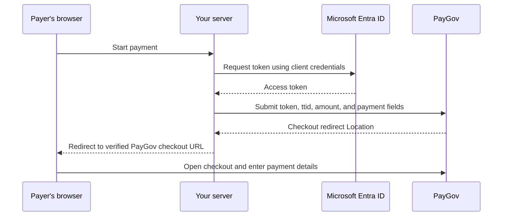

# PayGov Developer Portal

Integrate your application with PayGov's hosted checkout. Your application supplies the payment request; the payer enters payment details on PayGov's payment page.

**Use PayGov Secure for new integrations.** Classic POST remains available for backward compatibility.

## Choose Your Integration

| Method | Use it for | Start here |
|--------|------------|------------|
| PayGov Secure | New integrations using server-side Microsoft Entra authentication | [Secure quickstart](API_DOCUMENTATION.md#paygov-secure-quickstart) |
| Classic POST | Maintaining an existing shared-password integration | [Compatibility guide](API_DOCUMENTATION.md#classic-post-compatibility) |

## What Is a TTID?

A **Transaction Type ID**, also called a **TID** or **TTID**, is a number PayGov assigns to a configured payment type for your agency. Send it in the `ttid` request field so PayGov knows which payment setup and form to use.

For example, an agency may have one TTID for utility payments and another for permit fees. Each can have different [form fields supplied by PayGov](FORM_ENTITY_REFERENCE.md). Use the TTID provided for your payment type and environment; do not choose your own.

A TTID identifies the **type of payment**, not an individual payment or order. It is not a password or a substitute for authentication.

## Before You Start

Contact PayGov Integration Support through your established support channel to obtain your environment-specific setup values:

- Transaction Type ID (TID), sent as `ttid`.
- Secure authentication details: token URL, scope, client ID, and client secret.
- The exact form fields and requirements supplied for your TID.

Begin in QA. Production access and credentials are provisioned separately.

## How Secure Checkout Works

Your server authenticates and starts checkout; the payer's browser opens PayGov's payment page.

The client secret and access token stay on the server. Opening the payment page is not confirmation that a payment succeeded.

## Integration Steps

1. Follow the [Secure quickstart](API_DOCUMENTATION.md#paygov-secure-quickstart) from your application's server.
2. Send the payment request and direct the payer to hosted checkout.
3. Complete a PayGov-approved sandbox payment.
4. Arrange authoritative payment-status access before going live.

Opening checkout is not payment confirmation. See [payment results](API_DOCUMENTATION.md#payment-results) for how to handle the browser return and confirm live status.

## Reference

- [Endpoints and setup values](API_DOCUMENTATION.md#endpoints-and-setup-values)
- [Request fields](API_DOCUMENTATION.md#request-fields)
- [Fields supplied for your TID](FORM_ENTITY_REFERENCE.md)
- [Troubleshooting](API_DOCUMENTATION.md#troubleshooting)
- [Go-live checklist](API_DOCUMENTATION.md#go-live-checklist)
- [Support and PCI guidance](API_DOCUMENTATION.md#support)

Classic HTML examples are linked from the compatibility guide; they are not Secure integration templates.
